

# Tiveo

**مشغّل IPTV سريع يعتمد على جهاز التحكم عن بُعد أولًا، لأجهزة Android TV وGoogle TV. مجاني بالكامل.**

[English](README.md) · [Français](README.fr.md) · [Español](README.es.md) · **العربية**

  <a href="https://youtu.be/2_JoVCULfbs">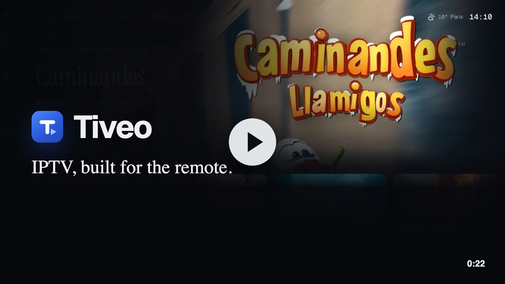</a>
   
  <a href="https://youtu.be/2_JoVCULfbs"><b>▶ شاهد الجولة التعريفية (22 ثانية)</b></a>

Tiveo مشغّل IPTV مصمَّم لغرفة المعيشة. تُحضر اشتراكك الخاص وتضيفه مرة واحدة، فتحصل على شاشة رئيسية أنيقة، وبثّ مباشر مع دليل كامل، وإعادة المشاهدة، والأفلام، والمسلسلات، والرياضة، وكل ذلك يُدار بجهاز التحكم عن بُعد. ويعمل التطبيق نفسه أيضًا على هواتف Android بواجهة تعمل باللمس.

Tiveo مشغّل فقط. فهو لا يتضمن أي قنوات أو قوائم تشغيل أو محتوى.

## التنزيل والتثبيت

احصل على أحدث ملف APK من **[صفحة الإصدارات (Releases)](https://github.com/warezfr/tiveo-releases/releases/latest)**.

Tiveo مجاني بالكامل: بلا سعر وبلا مشتريات داخل التطبيق.

للتثبيت اليدوي على Android TV أو Google TV:

1. نزّل ملف APK من أحدث إصدار (على التلفاز نفسه، أو على هاتف أو حاسوب ثم انسخه إلى التلفاز).
2. على التلفاز، افتح **الإعدادات > الخصوصية (Settings > Privacy)** (أو **الأمان والقيود (Security & restrictions)**) واسمح بخيار **تثبيت التطبيقات غير المعروفة (Install unknown apps)** للتطبيق الذي ستستخدمه لفتح ملف APK، مثل مدير الملفات.
3. افتح ملف APK بذلك التطبيق وأكّد التثبيت.
4. شغّل **Tiveo**. يرشدك معالج الإعداد إلى اختيار مظهر وإضافة مصدرك الأول.

يستطيع Tiveo التحقق من الإصدارات الجديدة من تلقاء نفسه ويعرض تثبيتها. ولذلك اسمح بخيار **تثبيت التطبيقات غير المعروفة (Install unknown apps)** لتطبيق Tiveo أيضًا.

## الميزات

### الشاشة الرئيسية

لوحة مميزة كبيرة، ثم صفوف تكمل من حيث توقفت: متابعة المشاهدة (Continue watching)، يُعرض الآن (On now)، المباريات (Matches)، القنوات المفضلة (Favorite channels)، قائمتي (My list)، وأحدث الأفلام والمسلسلات. يمكن تشغيل الصفوف أو إيقافها لكل ملف شخصي. وتوجد شارة للطقس (مدينة من اختيارك، بالدرجة المئوية C أو الفهرنهايت F) يمكن إيقافها. ويمكن لـ Tiveo أن يفتح على الشاشة الرئيسية، أو آخر قناة شاهدتها، أو قناة محددة، أو قائمتي.

<table>
  <tr>
    <td>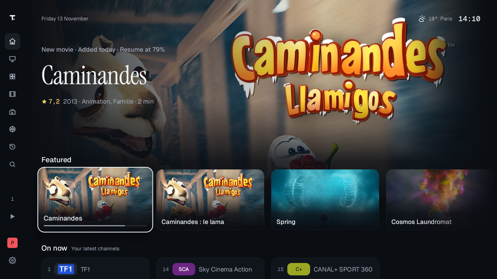</td>
    <td>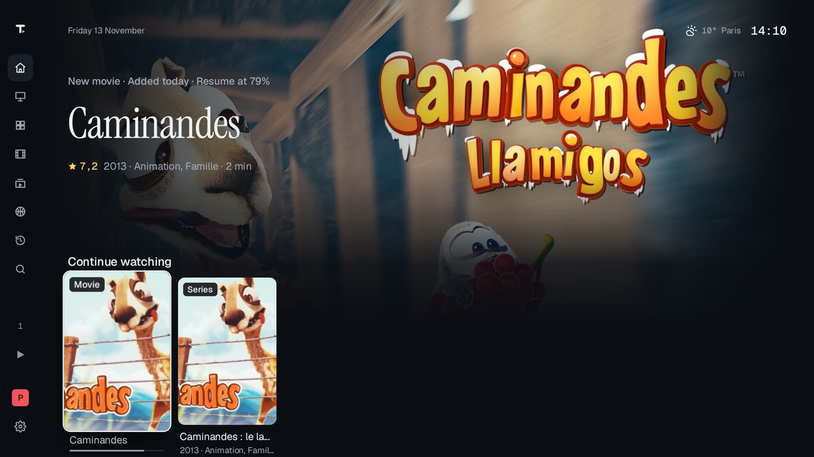</td>
  </tr>
</table>

### البث المباشر

تصفّح القنوات في شبكة أو قائمة أو مع معاينة في الأعلى. تُعرض القناة المحددة في معاينة مصغّرة مباشرة، مع البرنامج الحالي والتالي والوقت المتبقي لكل قناة.

- الفئات، والأخيرة، وجميع القنوات، والمفضلة (اضغط مطولًا على OK للإضافة، ويمكنك إعادة الترتيب)
- اكتب رقم القناة بجهاز التحكم؛ والسهمان لأعلى ولأسفل يبدّلان القناة
- الترتيب حسب ترتيب المزوّد أو الاسم أو الرقم
- اختر قناة مفضلة لتكون القناة التي يبدأ عليها Tiveo
- خيارات التبديل السريع بين القنوات: تحميل القناة التالية مسبقًا، ومدة الشريط المعلوماتي، ومهلة التبديل

  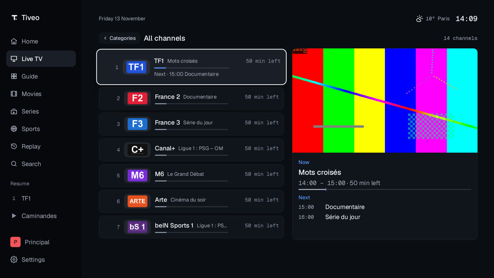

### دليل البرامج التلفزيونية

دليل كامل على شكل شبكة حسب القناة والوقت، من يوم واحد إلى 14 يومًا (7 أيام افتراضيًا)، مع إزاحة زمنية تصل إلى 12 ساعة في أي اتجاه إذا كانت بيانات الدليل مزاحة. يمكنك ضبط تذكير لبرنامج قادم، على شكل إشعار أو تبديل تلقائي إلى القناة. ويفتح الدليل فوق القناة التي تشاهدها.

  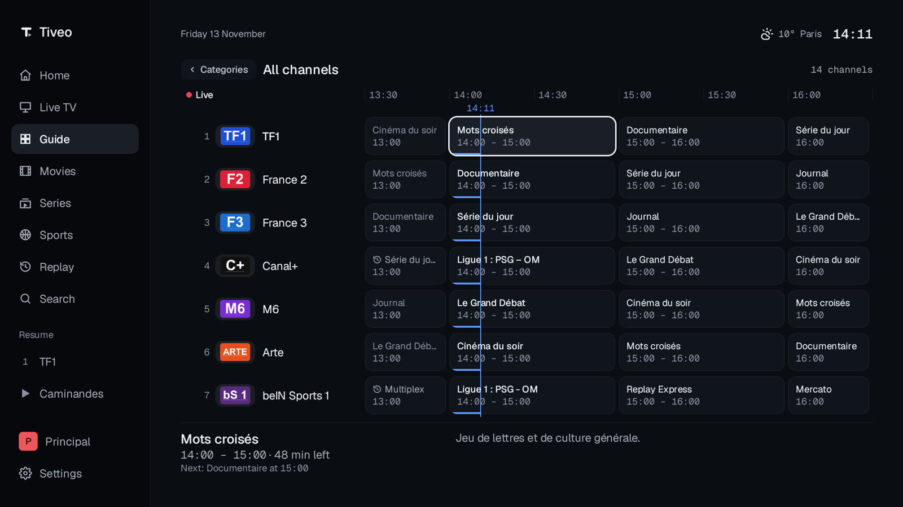

### إعادة المشاهدة

فاتك برنامج؟ اختر قناة لها أرشيف، ثم اختر يومًا (اليوم، أمس، أقدم)، ثم برنامجًا. يبدأ التشغيل من البداية. تعمل إعادة المشاهدة مع المزوّدين الذين يحتفظون بأرشيف، ويخبرك Tiveo بوضوح عندما لا تكون متاحة.

### الرياضة

يرصد Tiveo المباريات في بيانات دليلك، ويجمعها تحت «مباشر» (Live) و«اليوم» (Today) و«غدًا» (Tomorrow)، ويمنحك زرًا للمشاهدة على القناة الصحيحة. وتظهر المباريات القادمة أيضًا في الشاشة الرئيسية.

<table>
  <tr>
    <td>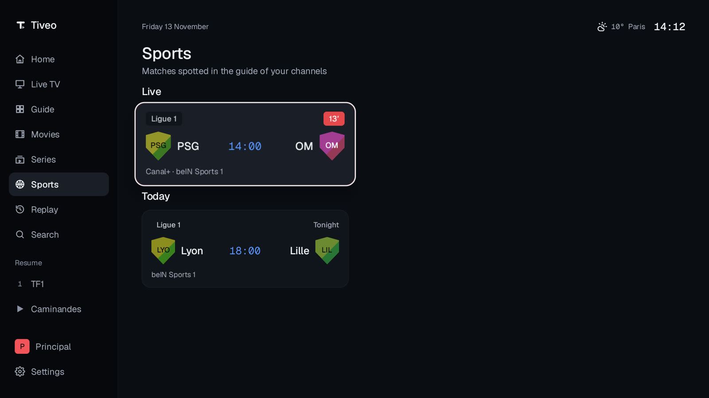</td>
    <td>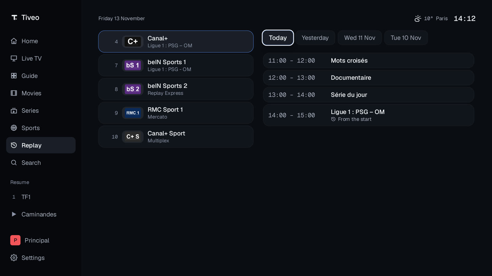</td>
  </tr>
</table>

### الأفلام والمسلسلات

تصفّح حسب الفئة، وافرز حسب ترتيب المزوّد أو الاسم أو تاريخ الإضافة أو التقييم. تعرض صفحات التفاصيل الملخص والممثلين والمخرج والتقييم والعناوين المشابهة.

- استأنف من حيث توقفت، أو ابدأ من البداية
- مسلسلات بمواسم وحلقات خاصة وقوائم حلقات وعلامات المشاهدة ورموز مثل «S1 E3»
- تبدأ الحلقة التالية تلقائيًا مع عدّ تنازلي يمكنك إلغاؤه
- قائمتي (My list) لحفظ العناوين لوقت لاحق
- رسائل واضحة وبلغة بسيطة عندما يُرجع الخادم خطأً

<table>
  <tr>
    <td>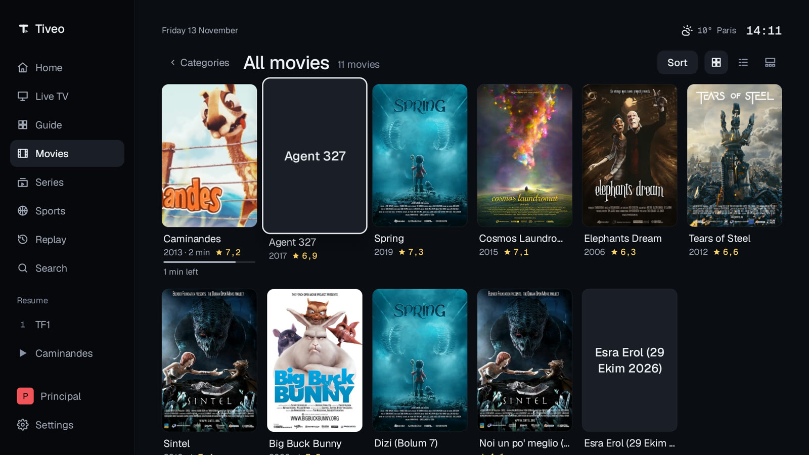</td>
    <td>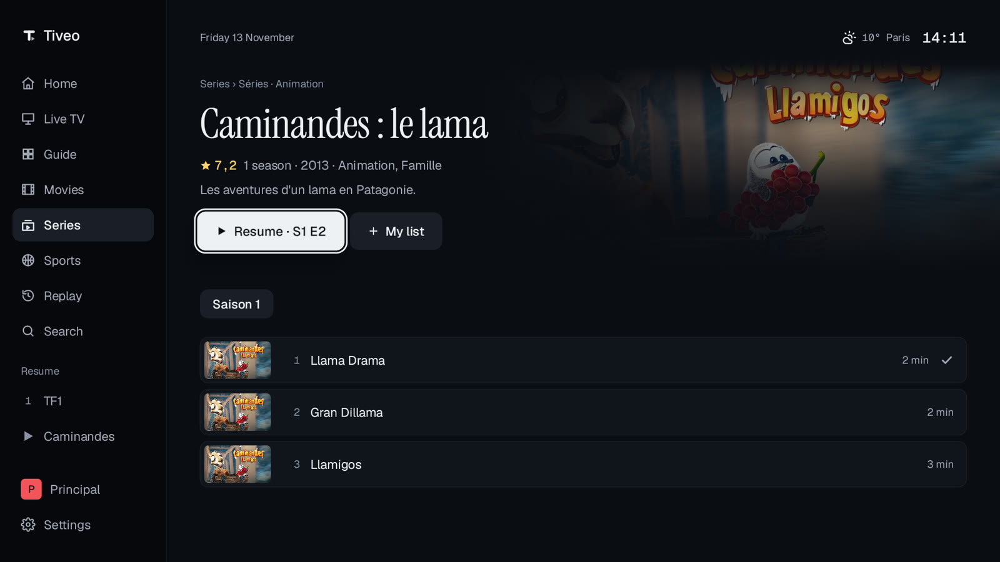</td>
  </tr>
</table>

### البحث

مربع بحث واحد للقنوات والبرامج (الحالية والقادمة) والأفلام والمسلسلات، مع نتائج مجمّعة حسب النوع. وللإعدادات بحثها الخاص أيضًا.

  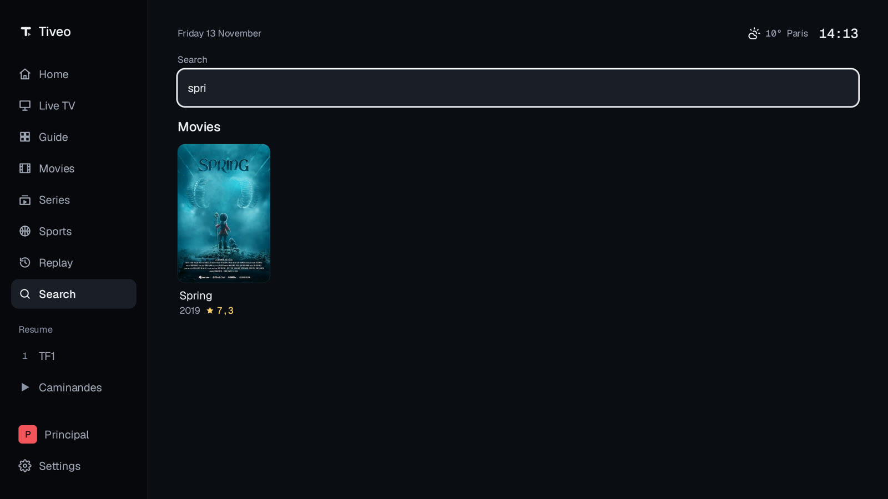

### المشغّل

- تفعيل فك التشفير بالعتاد أو إيقافه، وحد أقصى للجودة (تلقائي Auto، 1080، 720، 480)
- نسبة العرض إلى الارتفاع: ملاءمة (Fit)، ملء (Fill)، تمديد (Stretch)، 16:9، 4:3
- لوحة مسارات الصوت والترجمة، واللغات المفضلة، وحجم الترجمة وخلفيتها
- عناصر تحكم على الشاشة لقائمة القنوات والدليل والقنوات الأخيرة والمفضلة والقناة السابقة والتقديم أو الإرجاع بمقدار 10 أو 15 أو 30 ثانية
- إعادة اتصال تلقائية عند انقطاع البث المباشر، مع مهلة وعدد محاولات قابلين للضبط
- رسائل استئناف للأفلام والحلقات («استئناف عند 12:34»)
- صورة داخل صورة على الهواتف

### الملفات الشخصية والرقابة الأبوية

- عدة ملفات شخصية للمشاهدين، لكل منها اسمها ولونها ومفضلتها وسجلها ونقاط الاستئناف والمظهر والإعدادات
- شاشة «من يشاهد؟» عند بدء التشغيل، إن رغبت بها
- ملف الأطفال: تُخفى الفئات المقفلة، ويلزم رمز PIN للخروج منه
- رمز PIN أبوي من 4 أرقام مع قفل بعد المحاولات الخاطئة وخيار للاسترداد
- قفل الفئات بشكل منفصل للبث المباشر والأفلام والمسلسلات؛ وتُخفى فئات البالغين افتراضيًا

### الفئات والفهرس

أخفِ الفئات أو أظهرها لكل ملف شخصي، وحدّد هل تظهر الفئات الجديدة أم تبقى مخفية. ويمكنك أيضًا إعادة تسمية الفئات والقنوات، وإعادة ترتيبها، وإخفاء القنوات، وإعادة ضبط كل شيء.

### الإعدادات والمظاهر

مركز إعدادات على شكل بطاقات مع بحث، و«القائمة السريعة» (Quick list) التي تثبّت فيها الإعدادات الأكثر استخدامًا.

- 4 مظاهر: الأزرق الليلي (Night blue، الافتراضي)، الأبيض (White)، الباذنجاني (Aubergine)، الفيروزي (Teal)
- حجم النص: عادي (Normal)، كبير (Large)، كبير جدًا (Extra large)؛ ومفتاح لتقليل الحركة
- لغة الواجهة: النظام (System)، الفرنسية (French) أو الإنجليزية (English)
- صفحات لقائمتي (My list) والسجل (History)، وسجل أخطاء لمشكلات التشغيل والمزامنة والدليل

  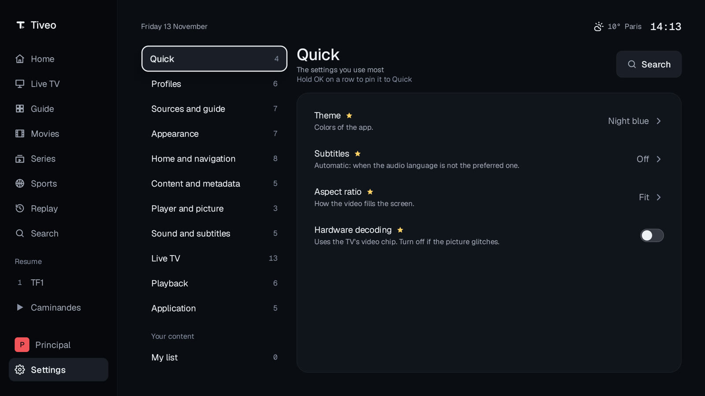

### النسخ الاحتياطي والاستعادة

صدّر مصادرك وملفاتك الشخصية وإعداداتك ومفضلتك وسجلك ونقاط الاستئناف إلى ملف، ثم استعدها على جهاز آخر. تُستثنى كلمات مرور المصادر وعناوينها ما لم تختر تضمينها، ولا تُصدَّر رموز PIN أبدًا. وبعد الاستعادة، يعيد Tiveo مزامنة مصادرك ويعرض تقريرًا بما تمت استعادته.

### على هاتفك

يتكيف ملف APK نفسه مع الهواتف بتنقل سفلي (الرئيسية Home، البث المباشر Live، الأفلام Movies، المسلسلات Series، المزيد More)، ونسخ تعمل باللمس من الدليل والبحث وإعادة المشاهدة والرياضة والملفات الشخصية والإعدادات، إضافة إلى الصورة داخل الصورة. صُمّم Tiveo للتلفاز أولًا، لذا لا تتوفر بعض المسارات الخاصة بالتلفاز على الهواتف.

## المصادر المدعومة

| المصدر | ما تحصل عليه |
| --- | --- |
| Xtream Codes (عنوان الخادم، اسم المستخدم، كلمة المرور) | البث المباشر والأفلام والمسلسلات والدليل وإعادة المشاهدة |
| قائمة تشغيل M3U / M3U8، مع عنوان دليل منفصل اختياري | البث المباشر، إضافة إلى الدليل عند توفره |
| بوابة Stalker / MAG (عنوان البوابة وعنوان MAC) | البث المباشر والأفلام والمسلسلات |
| دليل XMLTV | تلقائي مع Xtream؛ وعنوان إضافي اختياري لأي مصدر |

يمكنك إضافة عدة مصادر، وتحديد مصدر افتراضي، والتنقل بينها من ترويسة الصفحة. يختبر معالج الإعداد الاتصال قبل الحفظ، ويمكن للمصادر أن تتحدث في الخلفية.

## المتطلبات

- جهاز Android TV أو Google TV، أو هاتف Android، بنظام **Android 8.0 أو أحدث**
- جهاز تحكم عن بُعد مزوّد بـ D-pad للاستخدام على التلفاز
- اتصال بالإنترنت واشتراك IPTV أو قائمة تشغيل يحق لك استخدامها

## معلومات مفيدة

- Tiveo مشغّل وسائط. فهو لا يأتي مع أي قنوات أو قوائم تشغيل أو محتوى، ولا يوفّر ولا يبيع شيئًا منها. استخدم فقط المصادر التي يحق لك قانونيًا الوصول إليها.
- تعتمد إعادة المشاهدة على احتفاظ مزوّدك بأرشيف.
- يُعرض مصدر واحد فقط في كل مرة.
- معلومات الطقس، عند تفعيلها، مقدَّمة من MET Norway.
- تستخدم لقطات الشاشة بيانات قنوات تجريبية وأفلامًا مفتوحة من مؤسسة Blender، صادرة برخص Creative Commons.

## الملاحظات

وجدت خطأ أو لديك فكرة؟ افتح بلاغًا في [GitHub Issues](https://github.com/warezfr/tiveo-releases/issues). اذكر جهازك وإصدار Android وإصدار Tiveo (الإعدادات > التطبيق > حول (Settings > Application > About)).

---

© Tiveo. جميع الحقوق محفوظة. تُوزَّع الملفات التنفيذية لتطبيق Tiveo كما هي عبر GitHub Releases.

