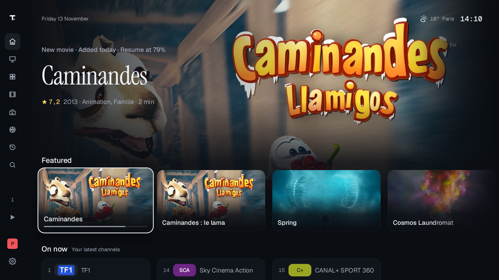
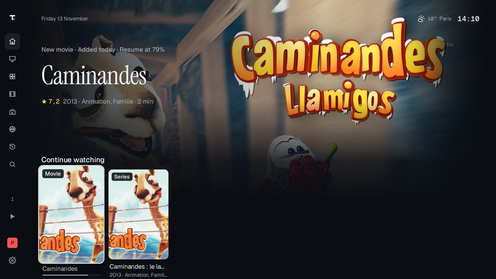
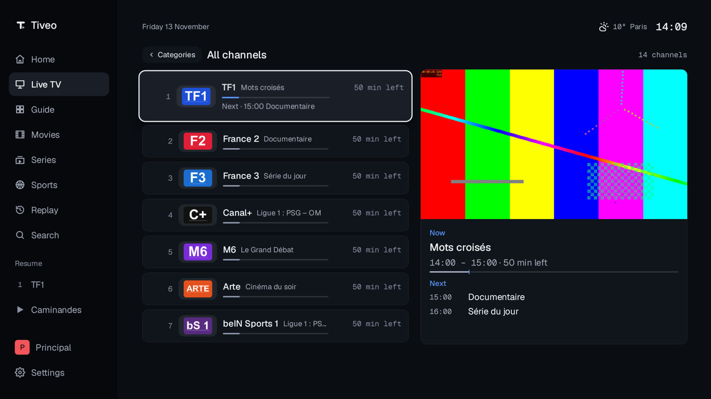
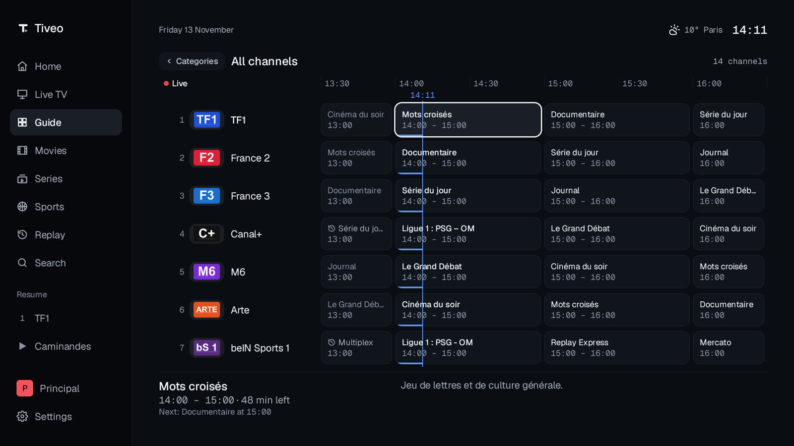
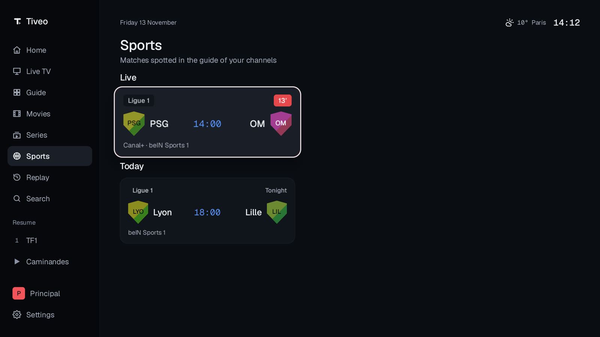
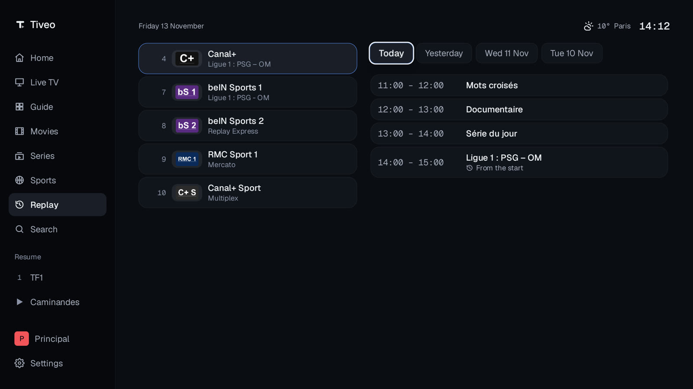
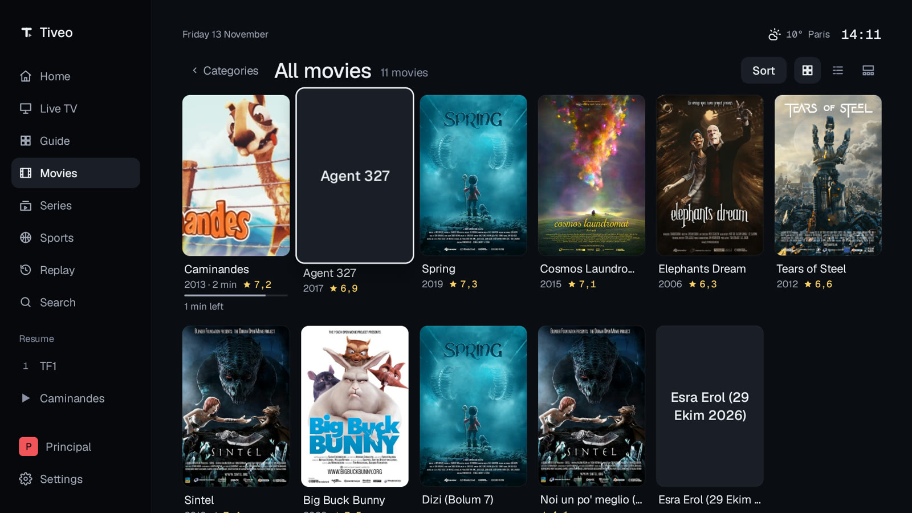
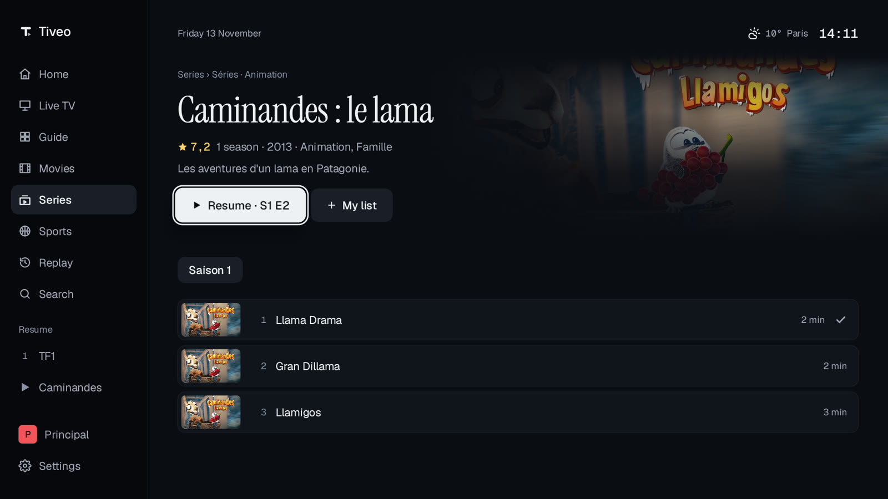
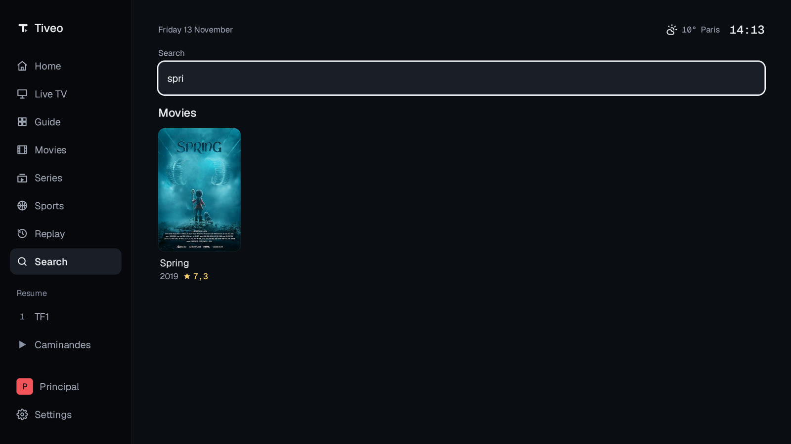
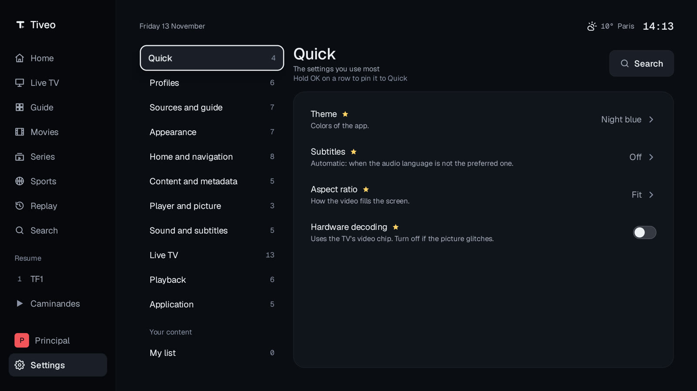

# Tiveo

**Un reproductor IPTV rápido y pensado para el mando a distancia, para Android TV y Google TV.**

[English](README.md) · [Français](README.fr.md) · **Español** · [العربية](README.ar.md)

  

Tiveo es un reproductor IPTV pensado para el salón. Tú aportas tu suscripción, la añades una sola vez y obtienes una pantalla de inicio limpia, TV en directo con guía completa, reproducción de programas ya emitidos (replay), películas, series y deportes, todo manejado con el mando a distancia. La misma aplicación también funciona en teléfonos Android con interfaz táctil.

Tiveo es solo un reproductor. No incluye canales, listas de reproducción ni contenido.

## Descarga e instalación

Descarga el último APK desde la **[página de Releases](https://github.com/warezfr/tiveo-releases/releases/latest)**.

Para instalarlo manualmente (sideload) en Android TV o Google TV:

1. Descarga el APK de la última versión (en la propia tele, o en un teléfono u ordenador y luego cópialo a la tele).
2. En la tele, abre **Ajustes > Privacidad** (Settings > Privacy; o **Seguridad y restricciones**, Security & restrictions) y permite **Instalar aplicaciones desconocidas** (Install unknown apps) a la aplicación con la que vayas a abrir el APK, por ejemplo un gestor de archivos.
3. Abre el APK con esa aplicación y confirma la instalación.
4. Inicia **Tiveo**. El asistente de configuración (setup wizard) te guía para elegir un tema y añadir tu primera fuente.

Tiveo puede comprobar por sí mismo si hay versiones nuevas y te ofrece instalarlas. Para ello, permite también **Instalar aplicaciones desconocidas** a Tiveo.

## Funciones

### Inicio

Un gran cartel destacado y, debajo, filas que retoman lo que dejaste: Seguir viendo (Continue watching), En directo ahora (On now), Partidos (Matches), Canales favoritos (Favorite channels), Mi lista (My list) y las últimas películas y series. Las filas se pueden activar o desactivar por perfil. Un indicador del tiempo (ciudad a tu elección, °C o °F) se puede desactivar. Tiveo puede abrirse en Inicio, en tu último canal, en un canal que elijas o en Mi lista.

  

### TV en directo

Explora los canales en cuadrícula, en lista o con una vista previa en la parte superior. El canal enfocado se reproduce en una minivista previa en vivo, con el programa actual y el siguiente, y el tiempo restante en cada canal.

- Categorías, Recientes, Todos los canales y Favoritos (mantén pulsado OK para añadir, y reordena)
- Escribe el número de un canal con el mando; arriba y abajo cambian de canal
- Ordena por orden del proveedor, nombre o número
- Elige un favorito como canal con el que arranca Tiveo
- Opciones de zapping rápido: precarga del siguiente canal, duración del banner, tiempo de espera del zapping

  

### Guía de TV

Una guía completa en cuadrícula por canal y hora, de 1 a 14 días (7 por defecto), con un desfase horario de hasta 12 horas en cualquier sentido si los datos de tu guía están desplazados. Programa un recordatorio en un programa próximo, como notificación o como cambio automático al canal. La guía se abre sobre el canal que estás viendo.

  

### Replay

¿Te perdiste un programa? Elige un canal con archivo, escoge un día (hoy, ayer, anteriores) y luego un programa. Se reproduce desde el principio. El replay funciona con los proveedores que conservan archivos, y Tiveo te avisa con claridad cuando no está disponible.

### Deportes

Tiveo detecta los partidos en los datos de tu guía, los agrupa en En directo, Hoy y Mañana, y te da un botón para verlos en el canal correcto. Los próximos partidos también aparecen en Inicio.

<table>
  <tr>
    <td></td>
    <td></td>
  </tr>
</table>

### Películas y series

Explora por categoría y ordena por orden del proveedor, nombre, fecha de incorporación o valoración. Las fichas muestran la sinopsis, el reparto, el director, la valoración y títulos similares.

- Reanuda donde lo dejaste o empieza desde el principio
- Series con temporadas, especiales, listas de episodios, marcas de visto y códigos como «S1 E3»
- El siguiente episodio empieza automáticamente, con una cuenta atrás que puedes cancelar
- Mi lista para guardar títulos para más tarde
- Mensajes claros y en lenguaje sencillo cuando un servidor devuelve un error

<table>
  <tr>
    <td></td>
    <td></td>
  </tr>
</table>

### Búsqueda

Un único cuadro de búsqueda para canales, programas (actuales y próximos), películas y series, con los resultados agrupados por tipo. Los ajustes tienen también su propia búsqueda.

  

### Reproductor

- Decodificación por hardware activada o desactivada, límite de calidad (Auto, 1080, 720, 480)
- Relación de aspecto: Ajustar, Rellenar, Estirar, 16:9, 4:3
- Panel de pistas de audio y subtítulos, idiomas preferidos, tamaño y fondo de los subtítulos
- Controles en pantalla para la lista de canales, la guía, los canales recientes, el favorito, el canal anterior y para avanzar o retroceder 10, 15 o 30 segundos
- Reconexión automática cuando se corta una emisión en directo, con tiempo de espera y reintentos configurables
- Avisos para reanudar películas y episodios («Reanudar en 12:34»)
- Imagen en imagen en teléfonos

### Perfiles y control parental

- Varios perfiles de espectador, cada uno con su nombre, color, favoritos, historial, puntos de reanudación, tema y ajustes
- Selector «¿Quién está viendo?» al arrancar, si lo quieres
- Perfil infantil: las categorías bloqueadas se ocultan y se necesita un PIN para salir de él
- PIN parental de 4 dígitos con bloqueo tras intentos fallidos y opción de recuperación
- Bloquea categorías por separado en TV en directo, Películas y Series; las categorías para adultos están ocultas por defecto

### Categorías y catálogo

Oculta o muestra categorías por perfil y decide si las categorías nuevas aparecen o permanecen ocultas. También puedes renombrar categorías y canales, reordenarlos, ocultar canales y restablecerlo todo.

### Ajustes y temas

Un centro de ajustes con tarjetas y búsqueda, y una Lista rápida (Quick list) donde fijas los ajustes que más usas.

- 4 temas: Azul noche (Night blue, por defecto), Blanco (White), Berenjena (Aubergine), Verde azulado (Teal)
- Tamaño del texto: Normal, Grande, Extra grande; un interruptor para reducir el movimiento
- Idioma de la interfaz: Sistema, francés o inglés
- Páginas para Mi lista, Historial y un registro de errores de reproducción, sincronización y guía

  

### Copia de seguridad y restauración

Exporta tus fuentes, perfiles, ajustes, favoritos, historial y puntos de reanudación a un archivo y restáuralos en otro dispositivo. Las contraseñas y direcciones de las fuentes se omiten salvo que elijas incluirlas, y los códigos PIN nunca se exportan. Tras una restauración, Tiveo vuelve a sincronizar tus fuentes y muestra un informe de lo que se ha recuperado.

### En tu teléfono

El mismo APK se adapta a los teléfonos con navegación inferior (Inicio, Directo, Películas, Series, Más), versiones táctiles de la guía, la búsqueda, el replay, los deportes, los perfiles y los ajustes, además de imagen en imagen. Tiveo está diseñado primero para la tele, así que algunos flujos propios de la TV no están disponibles en teléfonos.

## Fuentes compatibles

| Fuente | Qué obtienes |
| --- | --- |
| Xtream Codes (dirección del servidor, usuario, contraseña) | TV en directo, películas, series, guía y replay |
| Lista M3U / M3U8, con una dirección de guía independiente opcional | TV en directo, y la guía si se proporciona |
| Portal Stalker / MAG (dirección del portal y dirección MAC) | TV en directo, películas y series |
| Guía XMLTV | Automática con Xtream; una dirección adicional opcional para cualquier fuente |

Puedes añadir varias fuentes, definir una por defecto y cambiar entre ellas desde el encabezado de la página. El asistente de configuración prueba la conexión antes de guardar, y las fuentes pueden actualizarse en segundo plano.

## Requisitos

- Un dispositivo Android TV o Google TV, o un teléfono Android, con **Android 8.0 o posterior**
- Un mando a distancia con cruceta (D-pad) para usarlo en la tele
- Conexión a internet y una suscripción o lista IPTV que tengas derecho a usar

## Conviene saber

- Tiveo es un reproductor multimedia. No incluye canales, listas de reproducción ni contenido, y no proporciona ni vende ninguno. Usa solo fuentes a las que tengas derecho legal a acceder.
- El replay depende de que tu proveedor conserve un archivo.
- Solo se muestra una fuente a la vez.
- La información meteorológica, cuando está activada, la proporciona MET Norway.
- Las capturas de pantalla usan datos de canales de demostración y películas abiertas de la Blender Foundation, publicadas bajo licencias Creative Commons.

## Comentarios

¿Has encontrado un error o tienes una idea? Abre una incidencia en [GitHub Issues](https://github.com/warezfr/tiveo-releases/issues). Indica tu dispositivo, la versión de Android y la versión de Tiveo (Ajustes > Aplicación > Acerca de; Settings > Application > About).

---

© Tiveo. Todos los derechos reservados. Los binarios de la aplicación Tiveo se distribuyen tal cual a través de GitHub Releases.

