

# Tiveo

**Un lecteur IPTV rapide, pensé pour la télécommande, sur Android TV et Google TV. Totalement gratuit.**

[English](README.md) · **Français** · [Español](README.es.md) · [العربية](README.ar.md)

  <a href="https://www.youtube.com/watch?v=2_JoVCULfbs">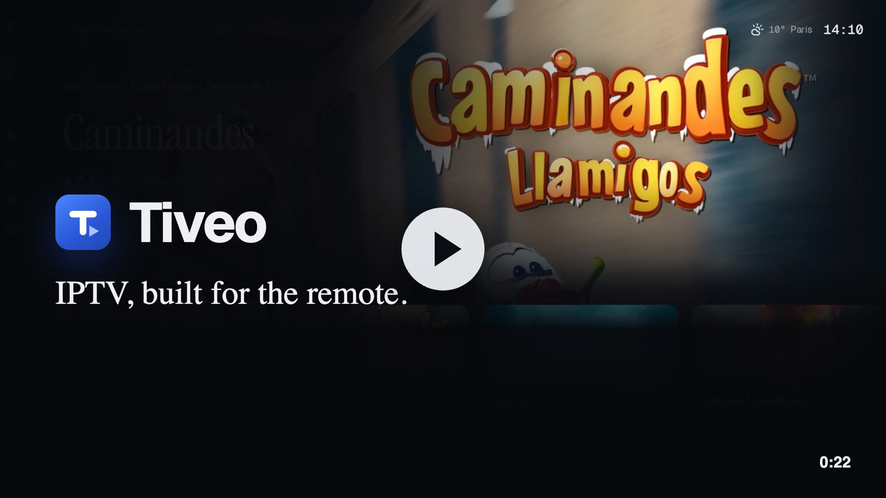</a>
   
  <a href="https://www.youtube.com/watch?v=2_JoVCULfbs"><b>▶ Voir la présentation en 22 secondes</b></a>

Tiveo est un lecteur IPTV conçu pour le salon. Vous apportez votre propre abonnement, vous l’ajoutez une seule fois, et vous obtenez un écran d’accueil clair, la télévision en direct avec un guide complet, le replay, les films, les séries et les sports, le tout piloté à la télécommande. La même application fonctionne aussi sur les téléphones Android, avec une interface tactile.

Tiveo est uniquement un lecteur. Il n’inclut ni chaînes, ni listes de lecture, ni contenus.

## Téléchargement et installation

Récupérez le dernier APK sur la **[page des versions](https://github.com/warezfr/tiveo-releases/releases/latest)**.

Tiveo est totalement gratuit : aucun prix, aucun achat dans l’application.

Pour l’installer manuellement sur Android TV ou Google TV :

1. Téléchargez l’APK de la dernière version (directement sur le téléviseur, ou sur un téléphone ou un ordinateur, puis copiez-le sur le téléviseur).
2. Sur le téléviseur, ouvrez **Paramètres > Confidentialité** (ou **Sécurité et restrictions**) et autorisez **Installer des applications inconnues** pour l’application qui servira à ouvrir l’APK, par exemple un gestionnaire de fichiers.
3. Ouvrez l’APK avec cette application et confirmez l’installation.
4. Lancez **Tiveo**. L’assistant de configuration vous guide pour choisir un thème et ajouter votre première source.

Tiveo peut vérifier seul la disponibilité de nouvelles versions et propose de les installer. Pour cela, autorisez aussi **Installer des applications inconnues** pour Tiveo.

## Fonctionnalités

### Accueil

Une grande affiche à la une, puis des rangées qui reprennent là où vous en étiez : Reprendre, En ce moment, Matchs, Chaînes favorites, Ma liste, et derniers films et séries. Les rangées peuvent être activées ou désactivées pour chaque profil. Une pastille météo (la ville de votre choix, en °C ou °F) peut être désactivée. Tiveo peut s’ouvrir sur l’Accueil, votre dernière chaîne, une chaîne choisie ou Ma liste.

<table>
  <tr>
    <td>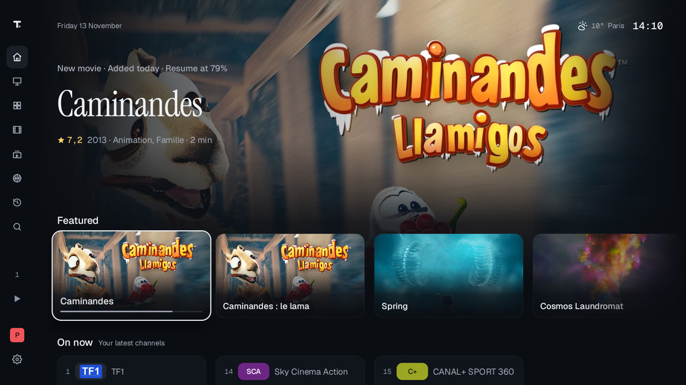</td>
    <td>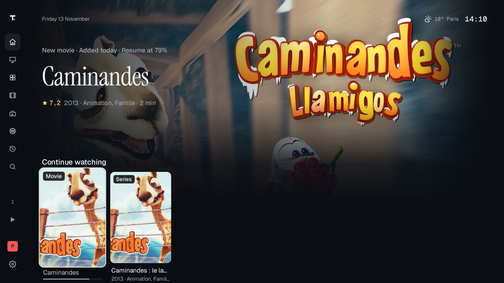</td>
  </tr>
</table>

### TV en direct

Parcourez les chaînes sous forme de grille, de liste ou avec un aperçu en haut. La chaîne sélectionnée s’affiche dans un mini-aperçu en direct, avec le programme en cours et le suivant, ainsi que le temps restant, pour chaque chaîne.

- Catégories, Récentes, Toutes les chaînes et Favoris (maintenez OK pour ajouter, puis réorganisez)
- Saisissez un numéro de chaîne à la télécommande ; haut et bas changent de chaîne
- Tri par ordre du fournisseur, par nom ou par numéro
- Choisissez un favori comme chaîne de démarrage de Tiveo
- Options de zapping rapide : préchargement de la chaîne suivante, durée de la bannière, délai de zapping

  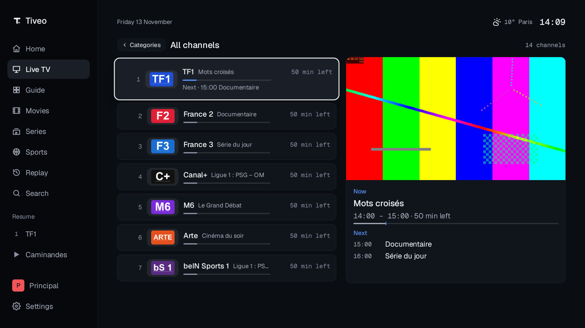

### Programme

Un guide complet en grille, par chaîne et par heure, de 1 à 14 jours (7 par défaut), avec un décalage horaire jusqu’à 12 heures dans un sens ou dans l’autre si les données de votre guide sont décalées. Définissez un rappel sur un programme à venir, sous forme de notification ou de bascule automatique vers la chaîne. Le guide s’ouvre par-dessus la chaîne que vous regardez.

  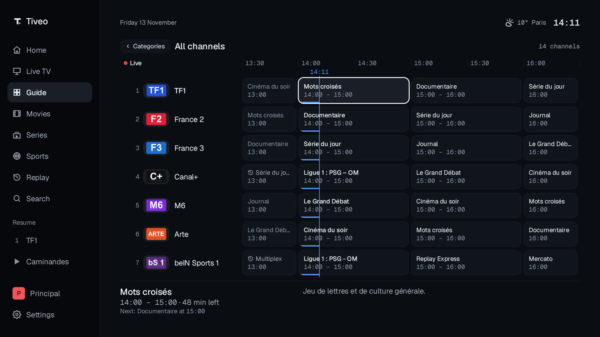

### Replay

Une émission manquée ? Choisissez une chaîne dotée d’une archive, un jour (aujourd’hui, hier, plus tôt), puis une émission. Elle démarre depuis le début. Le replay fonctionne avec les fournisseurs qui conservent des archives, et Tiveo vous indique clairement quand il n’est pas disponible.

### Sports

Tiveo repère les matchs dans les données de votre guide, les regroupe en En direct, Aujourd’hui et Demain, et vous propose un bouton pour les regarder sur la bonne chaîne. Les prochains matchs apparaissent aussi sur l’Accueil.

<table>
  <tr>
    <td>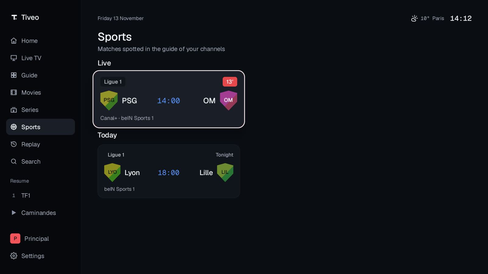</td>
    <td>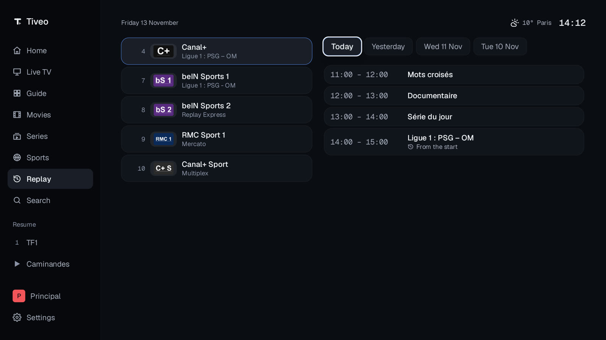</td>
  </tr>
</table>

### Films et séries

Parcourez par catégorie, avec un tri par ordre du fournisseur, par nom, par date d’ajout ou par note. Les pages de détail présentent le synopsis, la distribution, le réalisateur, la note et des titres similaires.

- Reprenez là où vous en étiez, ou recommencez depuis le début
- Séries avec saisons, épisodes spéciaux, listes d’épisodes, marques « vu » et codes « S1 E3 »
- L’épisode suivant démarre automatiquement, avec un compte à rebours que vous pouvez annuler
- Ma liste pour garder des titres de côté
- Des messages clairs, en langage simple, quand un serveur renvoie une erreur

<table>
  <tr>
    <td>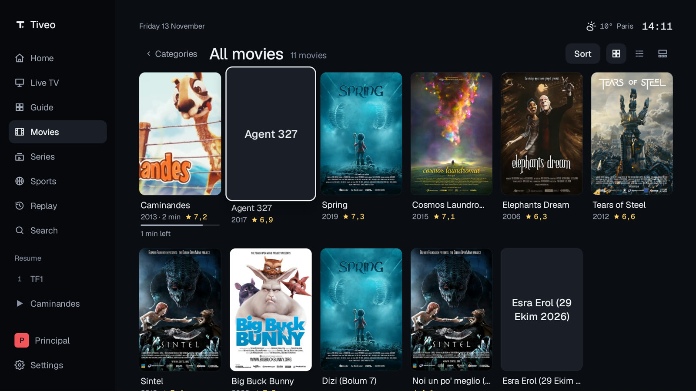</td>
    <td>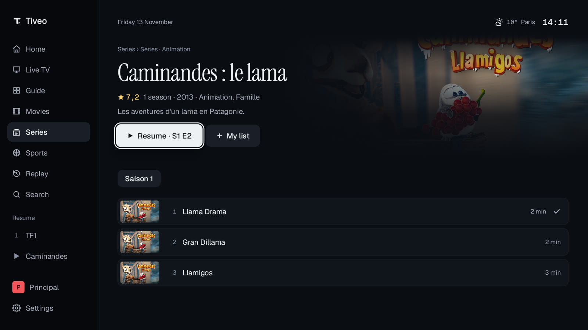</td>
  </tr>
</table>

### Recherche

Un seul champ de recherche pour les chaînes, les programmes (en cours et à venir), les films et les séries, avec des résultats regroupés par type. Les Réglages ont aussi leur propre recherche.

  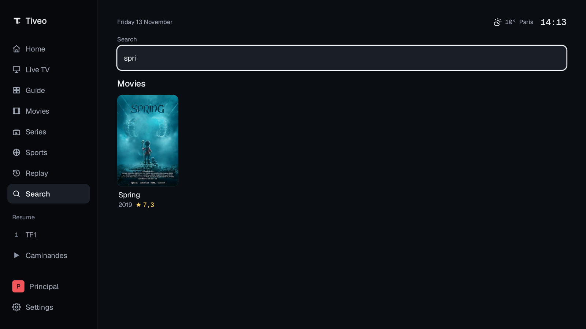

### Lecteur

- Décodage matériel activé ou non, plafond de qualité (Auto, 1080, 720, 480)
- Format d’image : Ajusté, Rempli, Étiré, 16:9, 4:3
- Panneau des pistes audio et des sous-titres, langues préférées, taille et fond des sous-titres
- Commandes à l’écran pour la liste des chaînes, le guide, les chaînes récentes, les favoris, la chaîne précédente et le défilement par 10, 15 ou 30 secondes
- Reconnexion automatique quand un flux en direct se coupe, avec délai et nombre d’essais configurables
- Invites de reprise pour les films et les épisodes (« Reprendre à 12:34 »)
- Image dans l’image sur les téléphones

### Profils et contrôle parental

- Plusieurs profils de spectateurs, chacun avec son nom, sa couleur, ses favoris, son historique, ses points de reprise, son thème et ses réglages
- Sélecteur « Qui regarde ? » au démarrage, si vous le souhaitez
- Profil enfant : les catégories verrouillées sont masquées, et un code PIN est nécessaire pour en sortir
- Code PIN parental à 4 chiffres, avec blocage après des essais erronés et une option de récupération
- Verrouillage des catégories séparément pour le Direct, les Films et les Séries ; les catégories pour adultes sont masquées par défaut

### Catégories et catalogue

Masquez ou affichez des catégories pour chaque profil et choisissez si les nouvelles catégories apparaissent ou restent masquées. Vous pouvez aussi renommer les catégories et les chaînes, les réorganiser, masquer des chaînes et tout réinitialiser.

### Réglages et thèmes

Un hub de réglages sous forme de cartes, avec recherche, et une liste rapide où vous épinglez les réglages que vous utilisez le plus.

- 4 thèmes : Bleu nuit (par défaut), Blanc, Aubergine, Pétrole
- Taille du texte : Normal, Grand, Très grand ; un interrupteur pour réduire les animations
- Langue de l’interface : Système, français ou anglais
- Pages pour Ma liste, l’Historique, et un journal des erreurs pour les problèmes de lecture, de synchronisation et de guide

  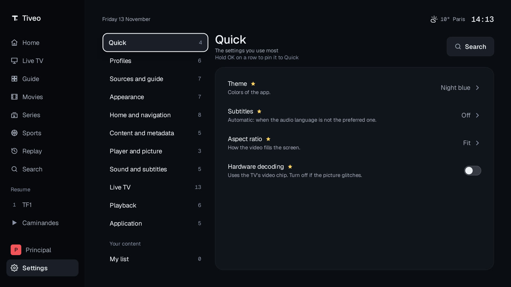

### Sauvegarde et restauration

Exportez vos sources, profils, réglages, favoris, historique et points de reprise vers un fichier, puis restaurez-les sur un autre appareil. Les mots de passe et les adresses des sources sont exclus, sauf si vous choisissez de les inclure, et les codes PIN ne sont jamais exportés. Après une restauration, Tiveo resynchronise vos sources et affiche un rapport de ce qui a été récupéré.

### Sur votre téléphone

Le même APK s’adapte aux téléphones, avec une navigation en bas de l’écran (Accueil, Direct, Films, Séries, Plus), des versions tactiles du guide, de la recherche, du replay, des sports, des profils et des réglages, ainsi que l’image dans l’image. Tiveo est conçu d’abord pour la télévision : quelques parcours propres au téléviseur ne sont donc pas disponibles sur téléphone.

## Sources prises en charge

| Source | Ce que vous obtenez |
| --- | --- |
| Xtream Codes (adresse du serveur, nom d’utilisateur, mot de passe) | TV en direct, films, séries, guide et replay |
| Liste M3U / M3U8, avec une adresse de guide séparée facultative | TV en direct, plus le guide s’il est fourni |
| Portail Stalker / MAG (adresse du portail et adresse MAC) | TV en direct, films et séries |
| Guide XMLTV | Automatique avec Xtream ; adresse supplémentaire facultative pour toute source |

Vous pouvez ajouter plusieurs sources, en définir une par défaut et passer de l’une à l’autre depuis l’en-tête de la page. L’assistant de configuration teste la connexion avant d’enregistrer, et les sources peuvent s’actualiser en arrière-plan.

## Configuration requise

- Appareil Android TV ou Google TV, ou téléphone Android, sous **Android 8.0 ou version ultérieure**
- Une télécommande avec croix directionnelle pour l’usage sur téléviseur
- Une connexion internet et un abonnement IPTV ou une liste de lecture que vous avez le droit d’utiliser

## Bon à savoir

- Tiveo est un lecteur multimédia. Il est livré sans chaînes, listes de lecture ni contenus, et n’en fournit ni n’en vend. N’utilisez que des sources auxquelles vous avez légalement le droit d’accéder.
- Le replay dépend de la conservation d’une archive par votre fournisseur.
- Une seule source est affichée à la fois.
- Les informations météo, lorsqu’elles sont activées, sont fournies par MET Norway.
- Les captures d’écran utilisent des données de chaînes de démonstration et des films libres de la Blender Foundation, publiés sous licences Creative Commons.

## Retours

Vous avez trouvé un bogue ou vous avez une idée ? Ouvrez un ticket sur [GitHub Issues](https://github.com/warezfr/tiveo-releases/issues). Indiquez votre appareil, la version d’Android et la version de Tiveo (Réglages > Application > À propos).

---

© Tiveo. Tous droits réservés. Les binaires de l’application Tiveo sont distribués en l’état via GitHub Releases.

