

# Tiveo

**A fast, remote-first IPTV player for Android TV and Google TV. Completely free.**

**English** · [Français](README.fr.md) · [Español](README.es.md) · [العربية](README.ar.md)

  <a href="https://youtu.be/2_JoVCULfbs">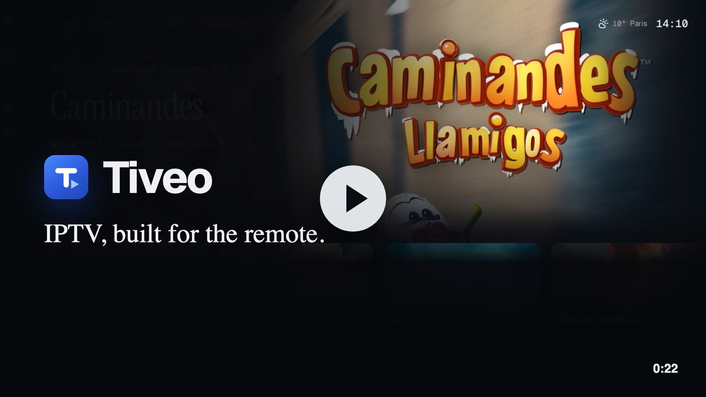</a>
   
  <a href="https://youtu.be/2_JoVCULfbs"><b>▶ Watch the 22-second tour</b></a>

Tiveo is an IPTV player built for the living room. You bring your own subscription, add it once, and get a clean home screen, live TV with a full guide, replay, movies, series and sports, all driven by the remote. The same app also runs on Android phones with a touch interface.

Tiveo is a player only. It includes no channels, playlists or content.

## Download and install

Get the latest APK from the **[Releases page](https://github.com/warezfr/tiveo-releases/releases/latest)**.

Tiveo is completely free: no price, no in-app purchase.

To sideload on Android TV or Google TV:

1. Download the APK from the latest release (on the TV itself, or on a phone or computer and then copy it to the TV).
2. On the TV, open **Settings > Privacy** (or **Security & restrictions**) and allow **Install unknown apps** for the app you will use to open the APK, for example a file manager.
3. Open the APK with that app and confirm the installation.
4. Launch **Tiveo**. The setup wizard walks you through choosing a theme and adding your first source.

Tiveo can check for new versions on its own and offers to install them. For that, allow **Install unknown apps** for Tiveo as well.

## Features

### Home

A large featured billboard, then rows that pick up where you left off: Continue watching, On now, Matches, Favorite channels, My list, and latest movies and series. Rows can be switched on or off per profile. A weather chip (city of your choice, C or F) can be turned off. Tiveo can open on Home, your last channel, a chosen channel or My list.

<table>
  <tr>
    <td>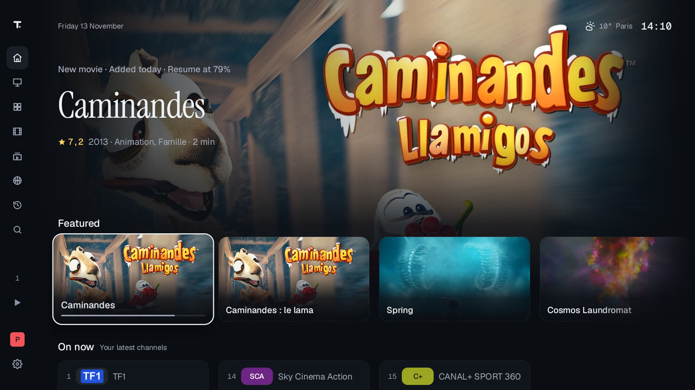</td>
    <td>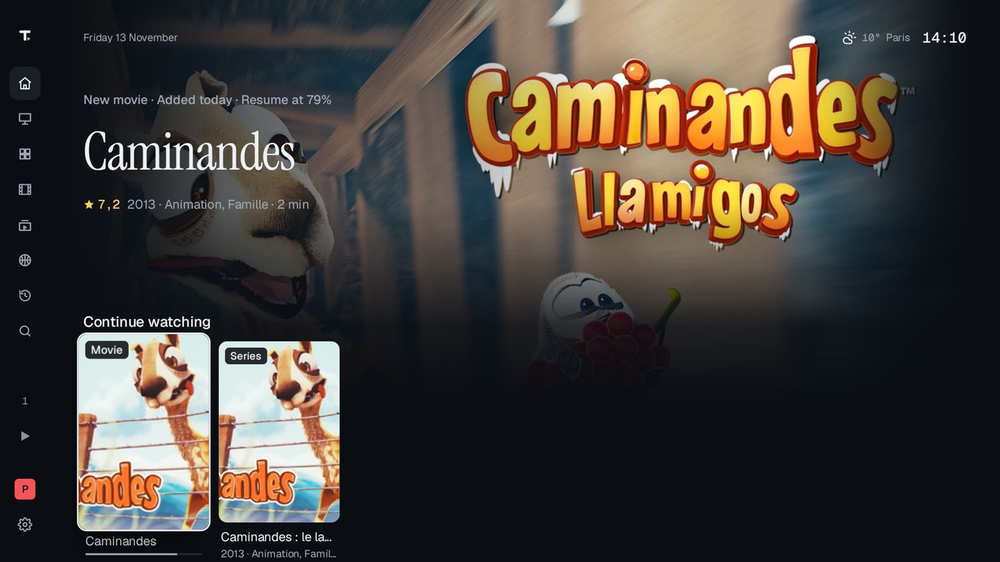</td>
  </tr>
</table>

### Live TV

Browse channels as a grid, a list or with a preview on top. The focused channel plays in a live mini preview, with the current and next programme and the time left on every channel.

- Categories, Recent, All channels and Favorites (hold OK to add, and reorder)
- Type a channel number on the remote; up and down switch channel
- Sort by provider order, name or number
- Pick a favorite as the channel Tiveo starts on
- Fast zapping options: preload the next channel, banner duration, zapping timeout

  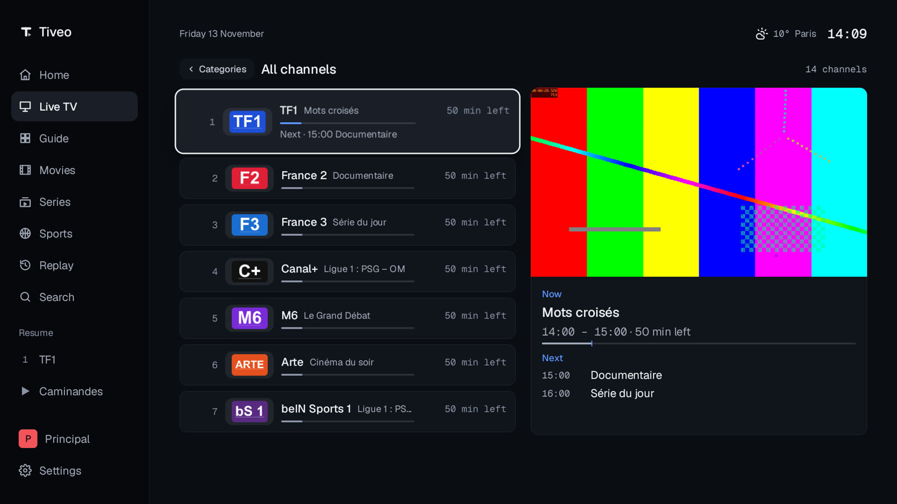

### TV guide

A full grid guide by channel and time, from 1 to 14 days (7 by default), with a time offset of up to 12 hours either way if your guide data is shifted. Set a reminder on an upcoming programme, as a notification or an automatic switch to the channel. The guide opens over the channel you are watching.

  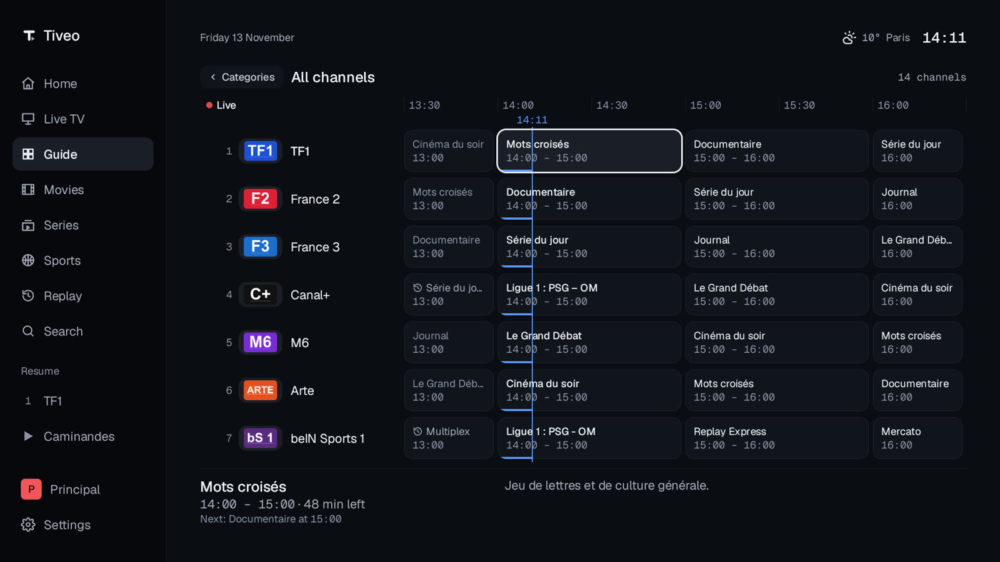

### Replay

Missed a programme? Pick a channel with an archive, choose a day (today, yesterday, earlier), then a programme. It plays from the start. Replay works with providers that keep archives, and Tiveo tells you plainly when it is not available.

### Sports

Tiveo spots matches in your guide data, groups them as Live, Today and Tomorrow, and gives you a button to watch on the right channel. Upcoming matches also appear on Home.

<table>
  <tr>
    <td>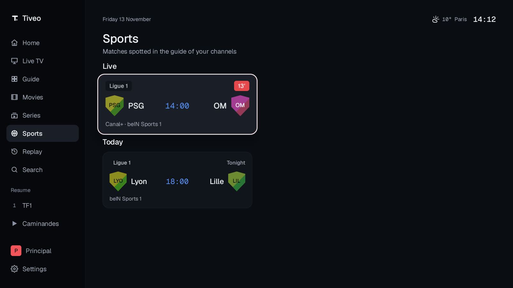</td>
    <td>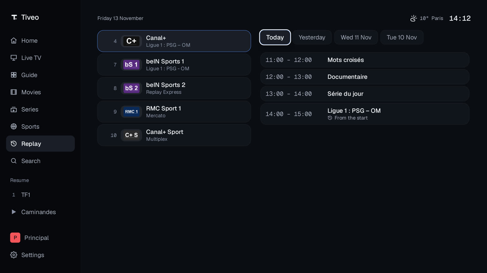</td>
  </tr>
</table>

### Movies and series

Browse by category, sort by provider order, name, date added or rating. Detail pages show the synopsis, cast, director, rating and similar titles.

- Resume where you left off, or start from the beginning
- Series with seasons, specials, episode lists, watched marks and "S1 E3" codes
- Next episode starts automatically, with a countdown you can cancel
- My list to save titles for later
- Clear, plain-language messages when a server returns an error

<table>
  <tr>
    <td>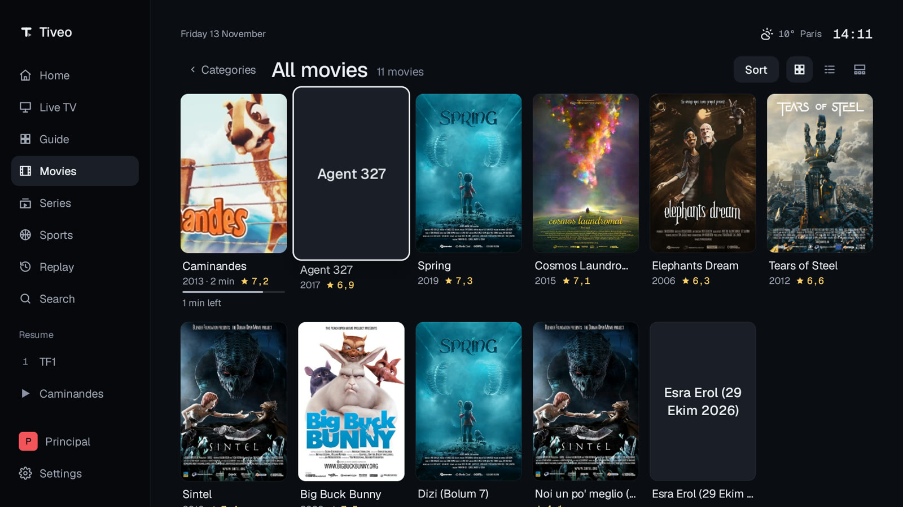</td>
    <td>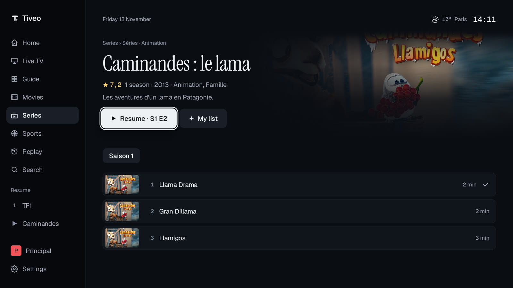</td>
  </tr>
</table>

### Search

One search box for channels, programmes (now and upcoming), movies and series, with results grouped by type. Settings has its own search too.

  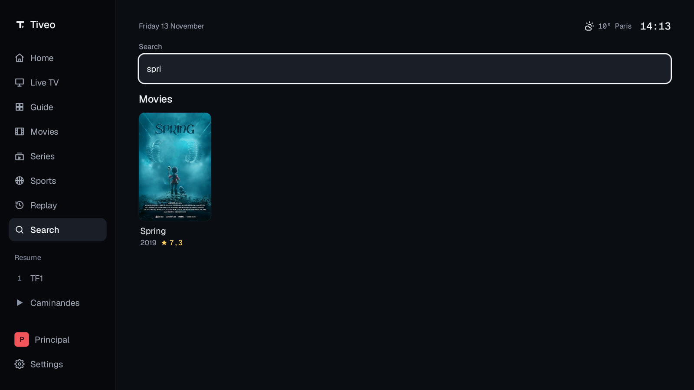

### Player

- Hardware decoding on or off, quality cap (Auto, 1080, 720, 480)
- Aspect ratio: Fit, Fill, Stretch, 16:9, 4:3
- Audio and subtitle track panel, preferred languages, subtitle size and background
- On-screen controls for channel list, guide, recent channels, favorite, previous channel and seeking by 10, 15 or 30 seconds
- Automatic reconnection when a live stream drops, with configurable timeout and retries
- Resume prompts for movies and episodes ("Resume at 12:34")
- Picture-in-picture on phones

### Profiles and parental control

- Several viewer profiles, each with its own name, color, favorites, history, resume points, theme and settings
- "Who's watching?" picker at startup, if you want it
- Kid profile: locked categories are hidden, and a PIN is needed to leave it
- 4-digit parental PIN with lockout after wrong attempts and a recovery option
- Lock categories separately for Live, Movies and Series; adult categories are hidden by default

### Categories and catalogue

Hide or show categories per profile and choose whether new categories appear or stay hidden. You can also rename categories and channels, reorder them, hide channels and reset everything.

### Settings and themes

A card-style settings hub with search, and a Quick list where you pin the settings you use most.

- 4 themes: Night blue (default), White, Aubergine, Teal
- Text size: Normal, Large, Extra large; a reduce-motion switch
- Interface language: System, French or English
- Pages for My list, History, and an error log for playback, sync and guide problems

  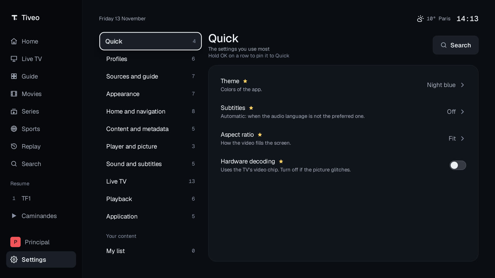

### Backup and restore

Export your sources, profiles, settings, favorites, history and resume points to a file, and restore them on another device. Source passwords and addresses are left out unless you choose to include them, and PIN codes are never exported. After a restore, Tiveo re-syncs your sources and shows a report of what was brought back.

### On your phone

The same APK adapts to phones with bottom navigation (Home, Live, Movies, Series, More), touch versions of the guide, search, replay, sports, profiles and settings, plus picture-in-picture. Tiveo is designed TV-first, so a few TV-specific flows are not available on phones.

## Supported sources

| Source | What you get |
| --- | --- |
| Xtream Codes (server address, username, password) | Live TV, movies, series, guide and replay |
| M3U / M3U8 playlist, with an optional separate guide address | Live TV, plus the guide when provided |
| Stalker / MAG portal (portal address and MAC address) | Live TV, movies and series |
| XMLTV guide | Automatic with Xtream; an optional extra address for any source |

You can add several sources, set a default and switch between them from the page header. The setup wizard tests the connection before saving, and sources can refresh in the background.

## Requirements

- Android TV or Google TV device, or an Android phone, running **Android 8.0 or later**
- A remote with a D-pad for TV use
- An internet connection and an IPTV subscription or playlist that you are entitled to use

## Good to know

- Tiveo is a media player. It ships with no channels, playlists or content, and does not provide or sell any. Use only sources you are legally entitled to access.
- Replay depends on your provider keeping an archive.
- Only one source is shown at a time.
- Weather information, when enabled, is provided by MET Norway.
- The screenshots use demo channel data and open films from the Blender Foundation, released under Creative Commons licenses.

## Feedback

Found a bug or have an idea? Open an issue on [GitHub Issues](https://github.com/warezfr/tiveo-releases/issues). Mention your device, Android version and the Tiveo version (Settings > Application > About).

---

© Tiveo. All rights reserved. The Tiveo application binaries are distributed as-is through GitHub Releases.

